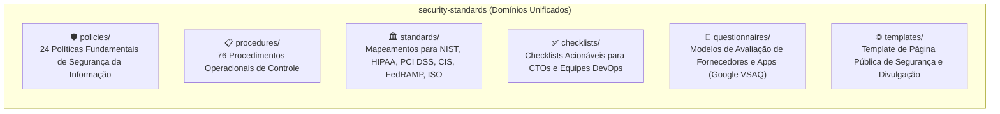

# Security Standards & Governance Repository

Bem-vindo ao repositório unificado de **Padrões, Políticas, Checklists e Governança de Segurança** da organização [`SecurityStandards`](https://github.com/SecurityStandards).

Este repositório foi construído com foco 100% em **Markdown estruturado de alta fidelidade**, servindo como base de conhecimento canônica para equipes humanas, auditorias regulatórias e agentes de inteligência artificial.

---

## 📂 Navegação por Domínios

### 1. 🛡️ [Políticas de Segurança (`policies/`)](policies/)
Modelos completos de políticas corporativas adotadas por empresas em conformidade com SOC 2, ISO 27001 e HIPAA:
* [`access.md`](policies/access.md) - Política de Controle de Acesso e Autenticação
* [`asset-mgmt.md`](policies/asset-mgmt.md) - Gestão e Classificação de Ativos
* [`bcdr.md`](policies/bcdr.md) - Continuidade de Negócios e Recuperação de Desastres (BCDR)
* [`breach.md`](policies/breach.md) - Gestão e Notificação de Violação de Dados
* [`data-protection.md`](policies/data-protection.md) - Proteção de Dados (em repouso, em trânsito e em uso)
* [`ir.md`](policies/ir.md) - Resposta a Incidentes de Segurança
* [`sdlc.md`](policies/sdlc.md) - Segurança no Ciclo de Vida de Desenvolvimento de Software
* [`threat.md`](policies/threat.md) - Gerenciamento e Defesa Contra Ameaças
* [`vendor.md`](policies/vendor.md) - Gestão de Riscos de Fornecedores e Terceiros
* [`vuln-mgmt.md`](policies/vuln-mgmt.md) - Gestão e Correção de Vulnerabilidades
* *[Consulte o índice completo em `policies/README.md`](policies/README.md)*

### 2. 📋 [Procedimentos de Controle (`procedures/`)](procedures/)
Mais de 70 procedimentos operacionais e administrativos de controle de segurança:
* Controle de acesso AWS, MFA, RBAC, VPN e rotação de senhas.
* Onboarding e offboarding seguro de colaboradores.
* Realização de testes de penetração (pentest), varreduras SAST e DAST.
* Playbooks de resposta a emergências e exercícios de simulação (tabletop).
* *[Consulte o índice completo em `procedures/README.md`](procedures/README.md)*

### 3. 🏛️ [Padrões e Frameworks Regulatórios (`standards/`)](standards/)
Mapeamento direto de controles normativos para consulta e auditoria:
* [**NIST CSF 1.1 / 2.0**](standards/nist-csf.md) - Identificar, Proteger, Detectar, Responder e Recuperar.
* [**CIS Controls**](standards/cis-controls.md) - Salvaguardas essenciais do Center for Internet Security.
* [**PCI DSS**](standards/pci-dss.md) - Controles para proteção de dados de cartões de crédito.
* [**HIPAA**](standards/hipaa.md) - Salvaguardas administrativas, físicas e técnicas para dados ePHI.
* [**FedRAMP**](standards/fedramp-moderate.md) - Parâmetros de segurança para contratações do setor público.
* [**SOC 2**](standards/soc2-security-controls.md) - Controles de segurança e confiança do AICPA.
* [**ISO/IEC 27002**](standards/iso-iec-27002-2013.md) - Código de práticas para controles de segurança da informação.
* *[Consulte o índice completo em `standards/README.md`](standards/README.md)*

### 4. ✅ [Checklists Operacionais (`checklists/`)](checklists/)
Checklists práticos em Markdown com checkboxes prontos para execução:
* [**SaaS CTO Security Checklist**](checklists/cto-security/README.md) - Proteção da empresa, colaboradores, código, infraestrutura e usuários dividida por estágio (Seed, Series A, Post-Series A).
* [**DevOps Security Checklist**](checklists/devops-security/README.md) - Boas práticas para pipelines CI/CD, gerenciamento de segredos, certificados TLS e servidores.

### 5. 📝 [Questionários de Avaliação de Fornecedores (`questionnaires/`)](questionnaires/)
Questionários de due diligence derivados do **Google VSAQ**:
* [`security_privacy_programs.md`](questionnaires/security_privacy_programs.md) - Avaliação geral do programa de segurança e privacidade.
* [`webapp.md`](questionnaires/webapp.md) - Avaliação de segurança de aplicações web de parceiros.
* [`infrastructure.md`](questionnaires/infrastructure.md) - Avaliação de infraestrutura e hospedagem.
* [`physical_and_datacenter.md`](questionnaires/physical_and_datacenter.md) - Segurança física e instalações.

### 6. 🌐 [Templates Institucionais (`templates/`)](templates/)
* [**Security Page & Responsible Disclosure**](templates/security-page/README.md) - Modelo de página pública (`/security`) com escopo de bug bounty, canais de reporte e compromissos com privacidade.

---

## 📜 Governança: Domain-Based Spec-Driven Development
Todas as decisões e mudanças seguem especificações organizadas por domínio em [`docs/specs/<domain>/`](docs/specs/domain-consolidation/).

Instruções mandatórias para agentes autônomos de IA constam em [AGENTS.md](AGENTS.md).
