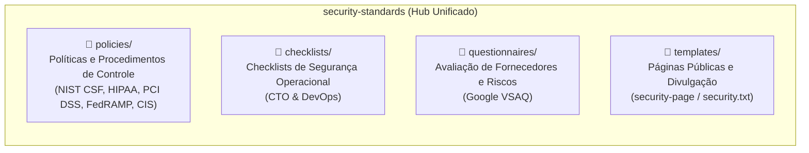

# Security Standards & Governance Repository

Bem-vindo ao repositório unificado de **Padrões, Políticas, Checklists e Governança de Segurança** da organização [`SecurityStandards`](https://github.com/SecurityStandards).

Este repositório consolida 5 iniciativas fundamentais de segurança cibernética em uma base canônica de dados, documentação e modelos:

---

## 📂 Estrutura de Conteúdo

### 1. 🛡️ [Políticas e Procedimentos (`policies/`)](policies/)
Modelos prontos para implementação de políticas de segurança e controles de conformidade estruturados em Markdown:
* **Mapeamentos Normativos:**
  * **NIST CSF** (National Institute of Standards and Technology Cybersecurity Framework)
  * **HIPAA** (Health Insurance Portability and Accountability Act)
  * **PCI DSS** (Payment Card Industry Data Security Standard)
  * **CIS Controls v7/v8** (Center for Internet Security)
  * **FedRAMP**
* **Políticas Inclusas:** Controle de Acesso, Resposta a Incidentes, Continuidade de Negócios, Segurança em Desenvolvimento de Software, Gestão de Riscos, Criptografia, etc.

### 2. ✅ [Checklists de Segurança (`checklists/`)](checklists/)
Checklists práticos para implementação rápida e auditoria interna:
* [**`cto-security/`**](checklists/cto-security/): Checklist essencial para CTOs e lideranças técnicas de startups SaaS (proteção de código, infraestrutura, acessos e auditoria).
* [**`devops-security/`**](checklists/devops-security/): Boas práticas para times de infraestrutura e engenharia (segurança de pipelines CI/CD, containers Docker/K8s, gerenciamento de secrets e nuvem).

### 3. 📝 [Questionários de Avaliação de Riscos (`questionnaires/`)](questionnaires/)
* [**`vsaq/`**](questionnaires/vsaq/): **Vendor Security Assessment Questionnaire** (Google VSAQ).
  * Aplicação web para conduzir questionários padronizados de autoavaliação com fornecedores e terceiros.

### 4. 🌐 [Templates de Páginas Públicas (`templates/`)](templates/)
* [**`security-page/`**](templates/security-page/): Modelo de página institucional de segurança para web apps, incluindo política de divulgação de vulnerabilidades (*Coordinated Disclosure*), contato de segurança e orientações de bug bounty.

---

## 🚀 Como Utilizar

### Para Auditorias e Compliance
Navegue até a pasta [`policies/`](policies/) e adote os templates correspondentes às normas exigidas pelos seus auditores (SOC2, ISO27001, HIPAA, PCI).

### Para Checagem Rápida de Equipe
Utilize os checklists em [`checklists/`](checklists/) como balizadores de DoD (*Definition of Done*) para deploys e revisões de infraestrutura.

### Para Avaliação de Prestadores de Serviço
Execute localmente ou hospede a ferramenta interativa [`questionnaires/vsaq/`](questionnaires/vsaq/) para enviar avaliações a parceiros.

---

## 📜 Governança e Contribuição
* Toda alteração arquitetural deve seguir as especificações em [`docs/specs/`](docs/specs/) conforme [Spec-Driven Development](docs/specs/001-consolidation/spec.md).
* Instruções para agentes automatizados estão definidas em [AGENTS.md](AGENTS.md).
